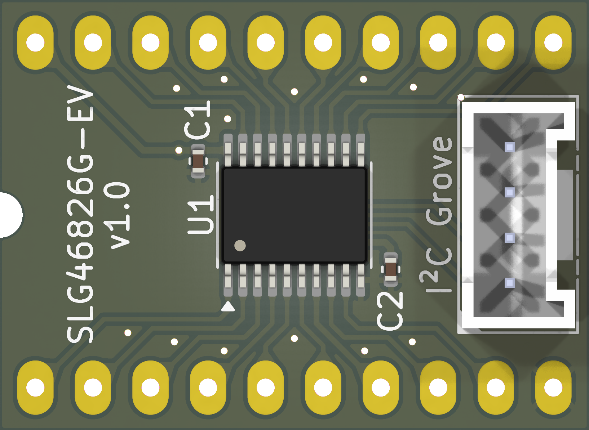
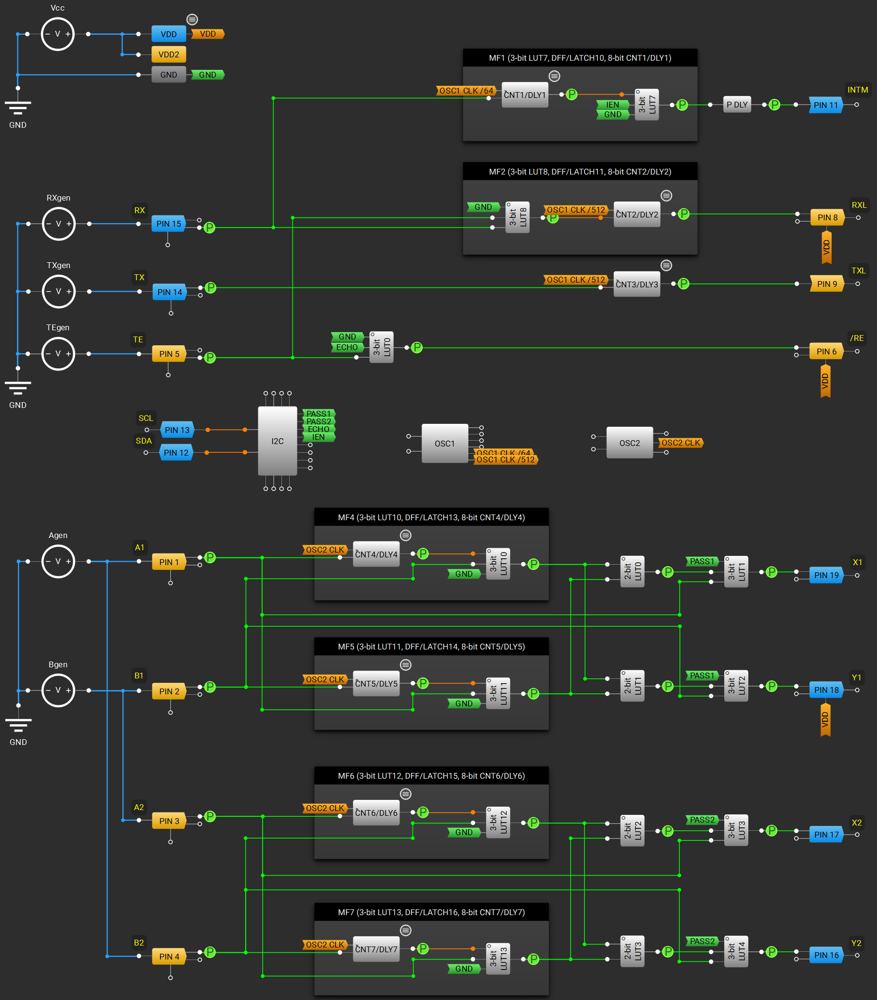
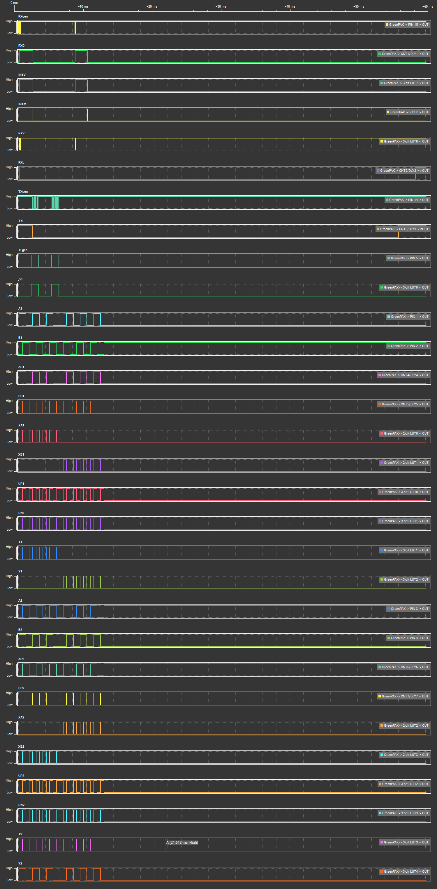

# Evaluation Board for Renesas SLG46826 (GreenPAK)<br>Carte d'évaluation pour Renesas SLG46826 (GreenPAK)

## 🌍 Language / Langue

[🇬🇧 English Version](#english-version) | [🇫🇷 Version Française](#version-française)

---

<div id="english-version"></div>

# 🇬🇧 English Version

This Open Source Hardware project features a minimalist evaluation and prototyping board for the **Renesas SLG46826** programmable mixed-signal matrix (GreenPAK™ family).

The board exposes all component inputs/outputs (I/Os) on a convenient wide DIL-20 format (2.54 mm pitch, 15.24 mm width) and integrates an I²C Grove connector for easy in-situ programming.

## 📌 Main Features

* **Target Component:** Renesas SLG46826G (configurable mixed-signal integrated circuit).
* **Practical Breadboard Format:** Wide DIL-20 pinout for direct insertion into breadboards or evaluation sockets.
* **Programming Interface:** On-board standard **Grove I²C** connector for simplified programming, configuration, and debugging via a dedicated programmer or an external microcontroller.
* **Stability:** Integrated decoupling capacitors required for power supply lines (VDD and VDD2).

## 📂 Repository Structure

The repository is organized as follows:

* 📁 `pdf/` : Contains the complete schematic diagram of the board in PDF format.
* 📁 `pics/` : Contains PCB photos, 3D renderings, and project illustrations.
* 📁 `prod/` : Contains the manufacturing files required for board production (by JLCPCB).
* 🛠️ *Design source files are available at the root (designed with KiCad 10).*

## 📐 Schematic Diagram

The schematic diagram was developed using KiCad. A ready-to-read exported version is available here:
 **[View the PDF Schematic](pdf/ev_board_v1.0.pdf)**

### Board Preview
<p align="center">
  
</p>

---

## 🚀 Example Application

Below is an example implementation of a digital logic circuit designed for the SLG46824 Matrix (SLG46826 without E²PROM).

### Matrix Logic Diagram
The internal routing and macrocells (LUTs, Counters, Oscillators) are configured to map the signals onto the available physical I/O pins.
<p align="center">
  
</p>

### NVM Data Configuration [View the NVM file](example/NVM_datas.txt)
This hex dump represents the non-volatile memory (NVM) configuration data ready to be written via the I²C interface to program the device:

```text
EC EA B6 EC EA B6 49 0D 34 CE CD 3C F7 02 D9 4A
64 03 00 00 00 00 00 00 00 00 D0 45 91 00 00 60
00 4C 03 34 0C A0 2C C0 A2 00 28 00 00 00 00 00
00 00 4C D4 5F 59 00 00 00 9C 18 FE D2 0F 00 00
00 00 00 00 00 00 00 00 00 00 00 00 00 00 00 00
00 00 00 00 00 00 00 00 00 00 00 00 00 00 00 00
00 80 00 00 80 80 71 71 02 02 80 FC 7C 00 00 31
51 51 51 51 00 00 00 00 00 00 50 00 00 00 00 00
03 00 00 00 00 14 22 30 0C 00 00 00 00 00 00 00
24 24 00 00 02 AC AC AC AC 00 00 00 00 68 00 00
00 00 00 20 00 01 00 04 C0 64 37 30 0E 65 08 C7
02 00 65 C7 21 41 00 00 02 04 41 00 02 20 41 00
00 02 02 41 00 00 02 00 00 00 01 01 01 00 00 00
00 00 00 00 00 00 00 00 00 00 00 00 00 00 00 00
00 00 00 00 00 00 00 00 00 00 00 00 00 00 00 00
00 00 00 00 00 00 00 00 00 00 00 00 00 00 00 A5
```

### Timing Diagram (Simulation)
The waveform diagram below shows the behavior and response of the configured macrocells over time against changing input stimuli.
<p align="center">
  
</p>

---

## 🔗 Useful Links & Documentation

* **Official Datasheet :** Find all the technical and electrical specifications on the [Renesas SLG46826 Product Page & Datasheet](https://renesas.com).
* **Design Software :** This PCB circuit was routed using [KiCad E.D.A. suite](https://kicad.org).

## ⚖️ License

This hardware project is open-source hardware. The PCB design is published under the following license:

**CERN Open Hardware Licence Version 2 - Strongly Reciprocal (CERN-OHL-S-2.0)**.

You are free to manufacture, modify, and distribute this board, provided that you maintain the same open-source sharing conditions for your own modifications (strong reciprocity).

---

<div id="version-française"></div>

# 🇫🇷 Version Française

Ce projet Open Source Hardware propose une carte d'évaluation et de prototypage minimaliste pour le circuit mixte programmable **Renesas SLG46826** (famille GreenPAK™).

La carte expose l'ensemble des entrées/sorties (I/O) du composant sur un format pratique DIL-20 large (au pas de 2,54 mm, largeur 15,24 mm) et intègre un connecteur I²C Grove pour faciliter sa programmation in-situ.

## 📌 Caractéristiques principales

* **Composant cible :** Renesas SLG46826G (circuit intégré à signaux mixtes configurables).
* **Format pratique :** Brochage type DIL-20 large pour une insertion directe sur plaque d'essai (*breadboard*) ou support d'évaluation.
* **Interface de programmation :** Connecteur embarqué au standard **Grove I²C** pour une programmation, une configuration et un débogage simplifiés à l'aide d'une interface de programmation ou d'un microcontrôleur externe.
* **Stabilité :** Intégration des condensateurs de découplage requis pour les lignes d'alimentation (VDD et VDD2).

## 📂 Structure du dépôt

Le dépôt est organisé de la manière suivante :

* 📁 `pdf/` : Contient le schéma électronique complet de la carte au format PDF.
* 📁 `pics/` : Contient les photos du PCB, les rendus 3D et les illustrations du projet.
* 📁 `prod/` : Contient les fichiers nécessaires pour la production de la carte (par JLCPCB).
* 🛠️ *Fichiers sources de conception disponibles à la racine (conçu avec KiCad 10)*.

## 📐 Schéma Électronique

Le schéma électrique a été développé sous KiCad. Une version exportée prête à la lecture est disponible directement ici :
 **[Consulter le schéma PDF](pdf/ev_board_v1.0.pdf)**

### Aperçu du circuit
<p align="center">
  
</p>

---

## 🚀 Exemple d'application

Voici un exemple d'implémentation de circuit logique numérique conçu pour la matrice du SLG46824 (SLG46826 sans E²PROM).

### Schéma Logique de la Matrice
Le routage interne ainsi que les macro-cellules (LUTs, Compteurs, Oscillateurs) sont configurés de manière à mapper les signaux sur les broches physiques de la carte.
<p align="center">
  
</p>

### Configuration des données NVM (NVM_datas.txt)
Ce bloc hexadécimal représente le contenu de configuration de la mémoire non-volatile (NVM) prêt à être écrit via l'interface I²C pour programmer le circuit :

```text
EC EA B6 EC EA B6 49 0D 34 CE CD 3C F7 02 D9 4A
64 03 00 00 00 00 00 00 00 00 D0 45 91 00 00 60
00 4C 03 34 0C A0 2C C0 A2 00 28 00 00 00 00 00
00 00 4C D4 5F 59 00 00 00 9C 18 FE D2 0F 00 00
00 00 00 00 00 00 00 00 00 00 00 00 00 00 00 00
00 00 00 00 00 00 00 00 00 00 00 00 00 00 00 00
00 80 00 00 80 80 71 71 02 02 80 FC 7C 00 00 31
51 51 51 51 00 00 00 00 00 00 50 00 00 00 00 00
03 00 00 00 00 14 22 30 0C 00 00 00 00 00 00 00
24 24 00 00 02 AC AC AC AC 00 00 00 00 68 00 00
00 00 00 20 00 01 00 04 C0 64 37 30 0E 65 08 C7
02 00 65 C7 21 41 00 00 02 04 41 00 02 20 41 00
00 02 02 41 00 00 02 00 00 00 01 01 01 00 00 00
00 00 00 00 00 00 00 00 00 00 00 00 00 00 00 00
00 00 00 00 00 00 00 00 00 00 00 00 00 00 00 00
00 00 00 00 00 00 00 00 00 00 00 00 00 00 00 A5
```

### Chronogramme (Simulation)
Le chronogramme ci-dessous illustre le comportement temporel et les signaux de réponse des macro-cellules configurées face aux stimuli d'entrée.
<p align="center">
  
</p>

---

## 🔗 Liens utiles & Documentation

* **Datasheet officielle :** Retrouvez toutes les spécifications techniques et électriques détaillées du circuit sur la [Page produit et Datasheet Renesas SLG46826](https://renesas.com).
* **Logiciel de conception :** Le circuit a été routé à l'aide des outils de la suite [KiCad E.D.A.](https://kicad.org).

## ⚖️ Licence

Ce projet matériel est un matériel libre (*Open Hardware*). La conception de ce circuit imprimé est publiée sous licence :

**CERN Open Hardware Licence Version 2 - Strongly Reciprocal (CERN-OHL-S-2.0)**.

Vous êtes libre de reproduire, modifier et distribuer cette carte, sous réserve de maintenir les mêmes conditions de partage ouvertes pour vos propres modifications (réciprocité forte).

---
© 2026 Olivier DENIZOT - delco-fr.com | Open Hardware
